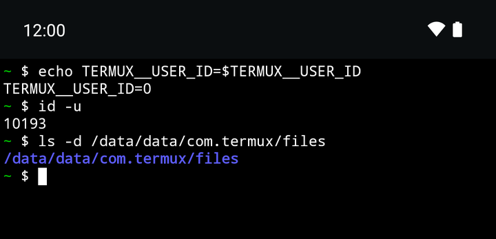
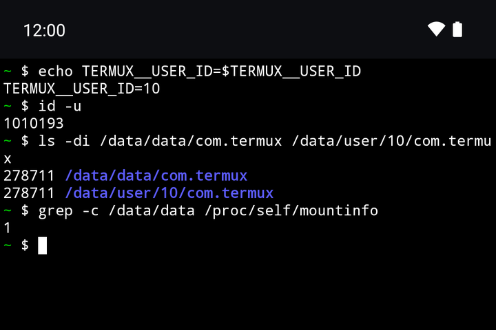
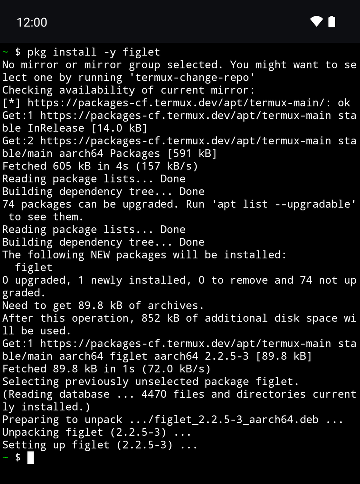
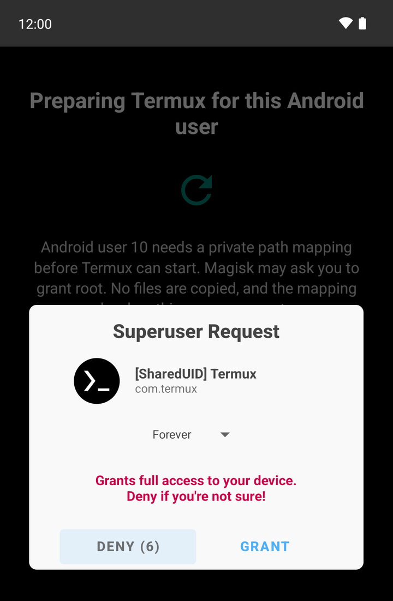
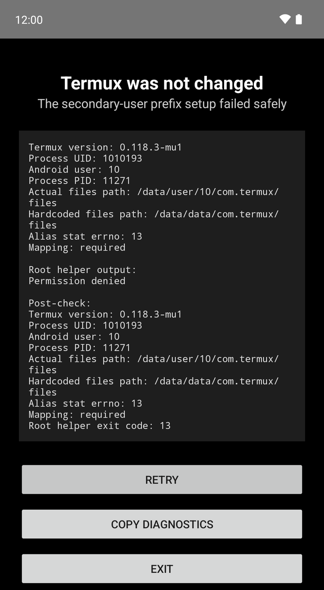
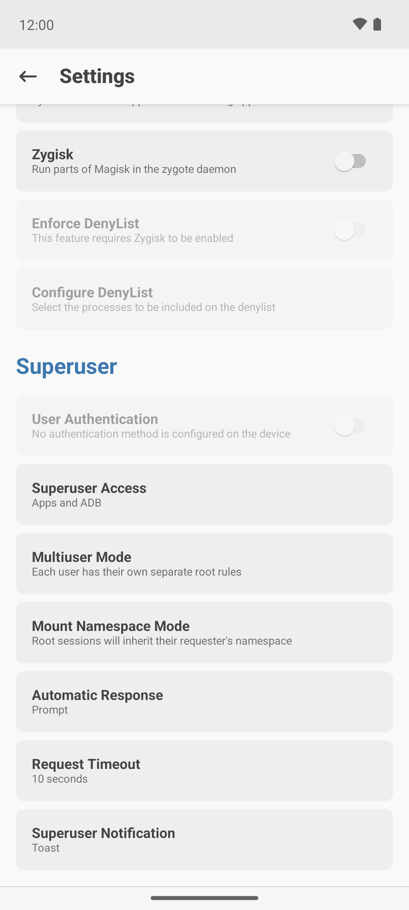
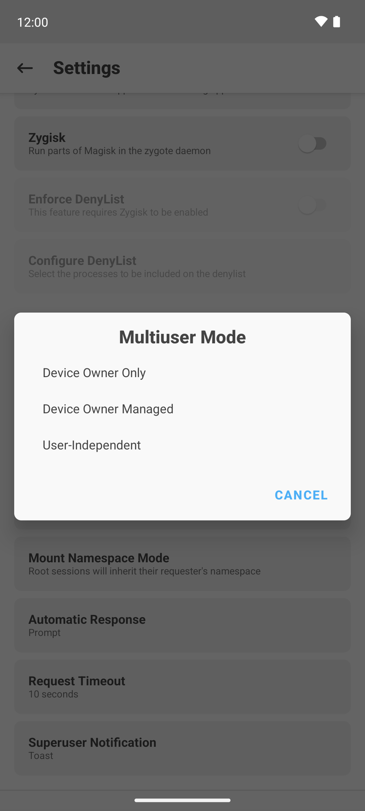
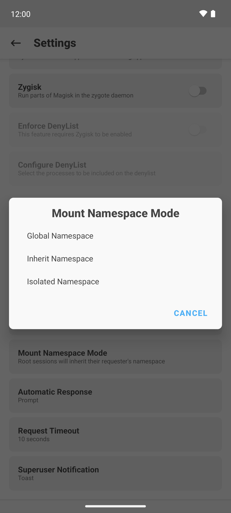
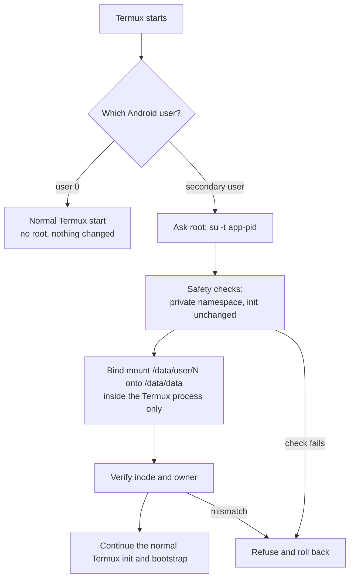
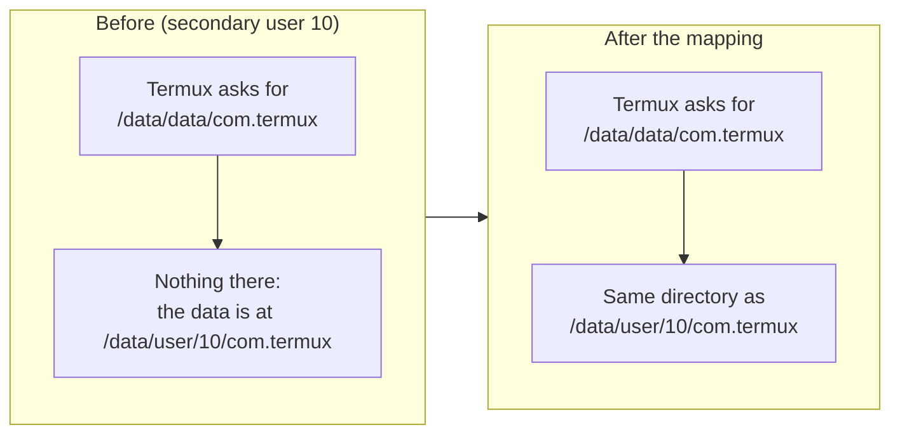

# Termux Secondary User Patcher

**Termux fails in your secondary Android user with *"can only be run as the primary user"*.
This makes it work, and leaves user 0 exactly as it was.**


> [!NOTE]
> **Status: pre-release, tested on a real device.** The patch series for Termux v0.118.3 is complete,
> builds in CI, and has been checked on a real device by an Android Labs tester (Google Pixel 8a),
> Android 17 (official Google ROM), Magisk 31.1, Multiuser Mode Device Owner Managed and
> User-Independent. The first signed release,
> [0.118.3-mu1](https://github.com/AndroidLabs-org/termux-secondary-user-patcher/releases/tag/v0.118.3-mu1),
> is available; the signed release build has not been run on a device yet, only the test build.

> [!IMPORTANT]
> **Root is required in secondary users.** In user 0 no root is used or requested.
> See [Why root?](#why-root)

| Overview | Details |
|---|---|
| **Fixes** | Termux refusing to run in an Android secondary user |
| **How** | A small patch set on official Termux, plus one root step per app process (a Magisk bind mount) |
| **What you install** | A full **replacement Termux APK** (official source plus the patches), signed with our key. Not an add-on: you uninstall official Termux first |
| **Package** | `com.termux`, so Termux's own packages and `pkg upgrade` keep working |
| **Base** | Termux v0.118.3, released as `0.118.3-mu1` |
| **Requires** | Magisk, in secondary users only |
| **User 0** | Unchanged: no root, no mount |

*Independent project by Android Labs. Not affiliated with or endorsed by the Termux project.*

## Contents

- [What it is](#what-it-is)
- [Screenshots](#screenshots)
- [Requirements](#requirements)
- [Magisk settings](#magisk-settings)
- [Install](#install)
- [Plugins](#plugins)
- [How it works](#how-it-works)
- [Security and trust](#security-and-trust)
- [FAQ](#faq)
- [Limitations](#limitations)
- [Versions and updates](#versions-and-updates)
- [Build it yourself](#build-it-yourself)
- [License and credits](#license-and-credits)

## What it is

[Termux](https://github.com/termux/termux-app) hardcodes its data path to
`/data/data/com.termux/...`. That is user 0's location. In a secondary user (user 10, 11, ...) the
app's real data lives in `/data/user/<N>/com.termux/...`, so upstream Termux refuses to install its
bootstrap there ("can only be run as the primary user").

This project is a small **patch set** for the official Termux app that makes it work in any
secondary user: multi-user phones, GrapheneOS profiles, and similar setups. It keeps the package
name `com.termux`, so Termux's own packages and `pkg upgrade` keep working unchanged.

**What you actually install is a complete Termux**, not a plugin or a layer on top of it. We apply the
patches to the official source, build it and sign it with our key. You install that APK **instead of**
official Termux (same package name, different signing key, so Android will not let one replace the
other: uninstall official Termux first, see [Install](#install)).

This repository holds **only the patches and build scripts**, not a fork. Every release is the
official Termux source at a pinned tag plus the patches in `patches/`, so anyone can see exactly
what was changed.

## Screenshots

All screenshots are from an **emulator** (Android 14, Magisk 26.4), with sample data only. Real-device
screenshots will be added after device testing.

### In practice

<table>
<tr>
<td align="center" valign="top" width="33%"><br><sub><b>User 0 is untouched.</b> Normal Termux, <code>TERMUX__USER_ID=0</code>, no root request.</sub></td>
<td align="center" valign="top" width="33%"><br><sub><b>Secondary user (10), after the mapping.</b> <code>/data/data/com.termux</code> and <code>/data/user/10/com.termux</code> are the same directory (same inode).</sub></td>
<td align="center" valign="top" width="33%"><br><sub><b>It is a normal Termux.</b> <code>pkg install</code> works from Termux's own repository in user 10.</sub></td>
</tr>
</table>

### The root request, and failing safely

<table>
<tr>
<td align="center" valign="top" width="50%"><br><sub><b>The one root request.</b> Magisk asks once; choose "Forever" to remember it.</sub></td>
<td align="center" valign="top" width="50%"><br><sub><b>Fails safely.</b> With Magisk's default Multiuser Mode the request is denied, and Termux says so. Nothing is changed.</sub></td>
</tr>
</table>

### The Magisk settings that matter

<table>
<tr>
<td align="center" valign="top" width="33%"><br><sub><b>Settings, Superuser section:</b> Multiuser Mode and Mount Namespace Mode.</sub></td>
<td align="center" valign="top" width="33%"><br><sub><b>Multiuser Mode:</b> use User-Independent or Device Owner Managed, not Device Owner Only.</sub></td>
<td align="center" valign="top" width="33%"><br><sub><b>Mount Namespace Mode:</b> Inherit Namespace.</sub></td>
</tr>
</table>

## Requirements

| Requirement | Details |
|---|---|
| Root | **Magisk (MagiskSU)**, with two settings (see [Magisk settings](#magisk-settings)): **Multiuser Mode** must **not** be "Device Owner Only" (the default), and **Mount Namespace Mode** should be "Inherit Namespace". |
| Android | Termux's own range (minSdk 21). Tested on Android 17. |
| Device tested | Google Pixel 8a (arm64), Android 17 (official Google ROM), Magisk 31.1 (0.118.3 test build), and, earlier, an arm64 phone with a custom Android ROM and Magisk (proof of concept) |
| Not yet tested | KernelSU / APatch, work profiles, other devices |

## Magisk settings

Two Magisk settings decide whether this works. The first one is **not** the default.

| Setting (Magisk → Settings) | Use | What happens otherwise |
|---|---|---|
| **Multiuser Mode** | **User-Independent**, or **Device Owner Managed** | **Device Owner Only** (the default) denies root to every user except user 0, so nothing can work in a secondary user. Termux shows a "setup failed safely" screen ([screenshot](#screenshots)). |
| **Mount Namespace Mode** | **Inherit Namespace** | **Global Namespace** behaves the same here, because this tool asks Magisk for the app's own namespace. **Isolated Namespace** is refused by the helper, with a message that tells you to switch to Inherit. |

**Magisk 31.1 has no interactive root prompt.** On it, grant Termux root in the Superuser tab (or by
hand, see below) before the first launch; the steps below that mention a prompt apply to Magisk
versions that show one. In User-Independent mode the grant must be for the secondary user's own uid
(user number x 100000 + Termux's app id), as each user has its own grant.

Where the root prompt appears depends on the Multiuser Mode:

- **User-Independent:** the prompt appears in the secondary user, so the **Magisk app must be
  installed in that user**. Without it, Magisk rejects the request immediately. Tested on an
  emulator: the prompt showed up in user 10 for "[SharedUID] com.termux", Grant was stored for that
  user's uid, and the mapping then worked. If the prompt runs out (about 10 seconds) while Termux is
  waiting, Magisk stores a **denial**; remove it in the Superuser tab (or delete the row) and try
  again. Here each user has its own grant, so a grant in user 0 does not apply to user 10.
- **Device Owner Managed:** the prompt appears in the **primary user** (user 0), not in the secondary user
  you are looking at. Approve it there, or grant Termux in the Superuser tab of the primary
  user's Magisk app first. The grant is per app and then applies to every user.
  Termux itself never asks for root in user 0, so nothing there prompts you or lists it, and it does
  not need to be installed in user 0. If you cannot answer the prompt in time, add the grant by hand
  from a root shell (the number is Termux's app id, here 10194; read yours from
  `dumpsys package com.termux | grep -m1 appId=`):

  ```bash
  su -c 'magisk --sqlite "REPLACE INTO policies (uid,policy,until,logging,notification) VALUES (10194,2,0,1,1)"'
  ```

  This was tested on an emulator with Termux removed from user 0: before the grant the root step timed
  out, after it the mapping worked at once, without any prompt.

## Install

> Download the APK for your device from the
> [latest release](https://github.com/AndroidLabs-org/termux-secondary-user-patcher/releases/latest)
> (`arm64-v8a` for almost every phone) and verify it, see
> [Verify the download](#verify-the-download).

This is a **clean install with no data migration**.

1. **Back up your Termux data.** Uninstalling deletes `$HOME`, packages and configuration.
2. **Uninstall official Termux and all its plugins in every Android user.** They share
   `sharedUserId com.termux`, so a copy signed with a different key left in any user causes
   `INSTALL_FAILED_UPDATE_INCOMPATIBLE`.
3. Set the [Magisk settings](#magisk-settings): Multiuser Mode to User-Independent or
   Device Owner Managed, Mount Namespace Mode to **Inherit Namespace**.
4. Unlock the secondary user, then install the APK. No plugins are released yet, and plugins in secondary users are limited, see [Plugins](#plugins).
5. Launch Termux and approve the superuser prompt (choose "remember"). Where the prompt appears
   depends on the Multiuser Mode, see above. On Magisk 31.1 there is no prompt: grant root first, see
   [Magisk settings](#magisk-settings). Wait for the normal bootstrap.
6. Check it worked:

   ```bash
   printf 'TERMUX__USER_ID=%s UID=%s\n' "$TERMUX__USER_ID" "$(id -u)"
   termux-setup-storage
   ```

## Plugins

Termux plugins (API, Boot, Float, Styling, Tasker, Widget) are separate apps that share the Termux
user id (`sharedUserId com.termux`). Android allows that only when the app and the plugins are signed
with the **same key**. That decides everything below.

- **Official plugins do not install next to this build.** Their key is the Termux project's, ours is
  different (`INSTALL_FAILED_SHARED_USER_INCOMPATIBLE`).
- **No plugin is released yet.** A plugin we ship has to be built and signed by us with our key.
- **Until then, the way to have plugins is to build and sign the app and the plugins yourself, with
  one key of your own.** The steps and a script are below.

### Which plugins work

Tested on an emulator only (Android 14, Magisk 26.4, secondary user 10).

| Plugin | Version | Main user (0) | Secondary user |
|---|---|---|---|
| Termux:Styling | 0.32.1 | Works | **Works** |
| Termux:API | 0.53.0 | Works | Fails |
| Termux:Boot | 0.8.1 | Works | Fails |
| Termux:Widget | 0.15.0 | Works | Fails |
| Termux:Tasker | 0.9.0 | Opens, no path error | Fails |
| Termux:Float | 0.17.0 | Works | Fails |

A plugin is a separate process, and the root step here maps the data directory for the Termux app
process only. Termux:API has a second problem: the `termux-api` program from the package repository
always addresses user 0.

**Experimental, not part of this release.** A separate experiment lets each plugin map itself, with
the same root script and only for an allow-listed plugin signed with the same key. On the emulator
it made Boot, Widget, Tasker, Float and API work in a secondary user, including after a reboot. It
is not shipped, has no real-device test, and the `termux-api` fix still has to reach the package
repository. Most people do not need the plugins, so none is promised.

### Sign your own app and plugins

You need one key, used for the app **and** for every plugin. Build once, sign everything in one run.

```bash
# 1. Create your key. Keep the file and the password:
#    without them you cannot update later.
keytool -genkeypair -keystore my-termux.jks -alias termux \
  -keyalg RSA -keysize 4096 -validity 10000
read -rsp "Key password: " STUP_STORE_PASSWORD
export STUP_STORE_PASSWORD
export STUP_KEY_PASSWORD=$STUP_STORE_PASSWORD
export STUP_KEYSTORE=$PWD/my-termux.jks STUP_KEY_ALIAS=termux

# 2. Build the app (JDK 11), then the plugins (JDK 17), unsigned.
#    SDK: platforms 30 and 35, build-tools, NDK 22.1.7171670 and 25.1.8937393
export ANDROID_HOME=...
export JAVA_HOME_11=...
export JAVA_HOME_17=...
JAVA_HOME=$JAVA_HOME_11 scripts/build.sh
scripts/build-plugins.sh             # all six, or: ... api styling

# 3. Sign everything in out/unsigned with your key
scripts/sign.sh                      # result: out/signed/
```

Then install from `out/signed/`: first uninstall official Termux and its plugins in every Android
user, install the app APK for your device, then the plugin APKs.

Things to know:

- **This is your own build.** It cannot be updated from, or replaced by, our release builds (or any
  build signed with another key). Switching later means a clean reinstall and loses the data.
- **Keep your key.** Anyone with the key and the password can publish updates that Android accepts as
  yours; losing it means a clean reinstall to change keys. Never commit it.
- `scripts/build-plugins.sh` also builds `termux-shared` first, because the plugins depend on a
  commit that JitPack never built. All pins (plugin tags, commits) are in `plugins.lock`.
- In a secondary user, only the plugins marked "Works" in the table above work, whoever signs them.

## How it works



- The mount is **process-local**. It exists only in the Termux app process's mount namespace and
  disappears when that process dies. Nothing is mounted globally.
- Termux's constants, bootstrap and packages are not modified.
- Shells get `TERMUX__USER_ID`, so `termux-setup-storage` and other `am`-based tools target the
  correct Android user.
- A `RUN_COMMAND` that arrives while the process is cold sets the mapping up first, then runs.

### Why root?

Android gives every user's app data a different path, and Termux's prefix is compiled into every
package. The only way to make the two agree without rebuilding every package is a bind mount, and
creating a mount needs root. That is why root is needed in secondary users and not in user 0.

### What the root step does

What Termux sees inside its own process, before and after:



The helper is a short shell script run once per Termux process through `su -t <pid>`. Its
essence, in the order it runs (full script: `SecondaryUserPrefixManager.java`, linked from
[docs/CHANGES.md](docs/CHANGES.md) once the series is published):

1. Refuse unless it really is root, and the user's `files` directory exists and is owned by the app.
2. Refuse unless `su` entered the **app's** mount namespace and that namespace is **not** init's.
3. Refuse if `/data` or `/data/data` is a shared mount (it could propagate to other processes).
4. Remember what init sees at `/data/data`.
5. The only change it makes:

   ```sh
   /system/bin/mount -o bind "/data/user/$USER_ID" "/data/data"
   ```

6. Check that init's view is **unchanged**, the mapped directory is the same inode as the source and
   has the right owner. If any check fails, `umount` and report the error.

It uses a fixed `PATH`, absolute paths to every tool, and only integers are put into the script.
(The mapping currently covers the user's whole `/data/user/<N>`; narrowing it to just
`com.termux` is planned for a later release.)

### What it does not do

- It does not touch SELinux or Android permissions; the normal checks still apply.
- It does not mount anything for other apps or for the system, and nothing survives the process.
- It does not change Termux's package name, prefix, bootstrap or packages.
- It adds no network code and no new Android permissions (checked in the patch diff).
- It does not use root in user 0, ever.
- It does not copy or move your data.

## Security and trust

### Why you can trust it

You are asked to give a root helper to a terminal app, so every claim below comes with a way to
check it yourself.

| Claim | How to check it |
|---|---|
| You can see everything that was changed | This repo is only the patches (`patches/`), not a fork. Official source + these patches = the release. |
| The APK is built from exactly that public code | `gh attestation verify <apk> --owner AndroidLabs-org`, `SHA256SUMS.txt`, and the full source tarball on every release. |
| Only we can publish updates | `apksigner verify --print-certs <apk>` must show the fingerprint [below](#verify-the-download). The key is private. |
| Root is used for one small, readable step | The whole helper is [shown above](#what-the-root-step-does) and lives in one file. |
| User 0 is untouched | The mapping code returns immediately in user 0; root is never requested. Checked on an emulator and by automated tests. |
| Nothing changes globally | The mount exists only inside the Termux process and is gone when it dies. The helper checks that init's mount view is unchanged and undoes the mount if not. |
| A broken upstream update cannot reach you | A new release is published only if the patches apply and the tests pass. Otherwise nothing ships. |

### What has been tested, and what has not

We would rather tell you exactly where we stand than say "works great". This table is updated with
every release.

| Area | Status |
|---|---|
| Mapping in a secondary user, **earlier proof-of-concept** | Worked on an arm64 phone with a custom Android ROM and Magisk |
| Mapping in a secondary user, **0.118.3 build, real device** | Worked on a Google Pixel 8a (Android 17, Magisk 31.1, 18 Nov 2026): shell in users 10 and 11, `TERMUX__USER_ID=10` / `11`, `pkg update` and package install, `termux-setup-storage`; user 0 normal, `TERMUX__USER_ID=0`, no Termux root request in logcat; Device Owner Managed and User-Independent both used |
| Static code review of the patch set (Oct 2026) | Done. No critical or high findings; a few reliability and hardening items are planned for a later release |
| Root helper script | Reviewed line by line; fixed `PATH`, absolute paths, integers only, rollback on every failed check. 32 automated tests drive each safety check and exit code (no device needed) |
| Build reproducibility | Built from official source at a pinned commit; the build refuses a moved tag |
| Release signing | One dedicated key, certificate fingerprint pinned in the release workflow |
| User 0 behaviour | Emulator, CI-built APK: installs, bootstraps, normal shell, no root request |
| Several secondary users (10, 11, both at once) | Worked on the Pixel 8a: both running at once, both passed their checks |
| Cold start from a plugin or `RUN_COMMAND` | Works by design, but the first launch can wait for the root prompt (up to 90 s). Improvements are planned for a later release |
| Mapping in a secondary user, **0.118.3 build, Magisk 26.4 on an emulator** | Worked: shell in user 10, `TERMUX__USER_ID=10`, mapping present only in the Termux process (init and other processes unaffected) |
| Magisk setting combinations (same emulator; logic also read in the current Magisk source) | Device Owner Only denied, Device Owner Managed and User-Independent work, Isolated Namespace refused cleanly, Global Namespace works like Inherit. The Magisk settings on the earlier proof-of-concept device are being confirmed |
| The interactive root prompt in each Multiuser Mode | Checked on the emulator: appears in user 0 (Device Owner Managed) or in the secondary user (User-Independent, Magisk app required there) |
| Termux plugins | Tested on the emulator (6 plugins). **Secondary user: only Termux:Styling works.** Main user: all six work. No plugin ships in this release, see [Plugins](#plugins) |
| KernelSU, APatch, work profiles | Not tested |

A release is published only after the items marked "test plan" pass on an emulator and on a real
device.

### Verify the download

Each release ships `SHA256SUMS.txt`, GitHub build attestations and a source tarball.

```bash
sha256sum -c SHA256SUMS.txt
gh attestation verify <apk> --owner AndroidLabs-org
apksigner verify --print-certs <apk>
```

The signing certificate SHA-256 must be:

```
dac9bda20bb9cb1a9be04fc9741d54e1ab14f09df049f911542b92e1f87c6393
```

Our signing key is private. Unlike Termux's GitHub builds, which use a publicly shared test key,
nobody else can sign an update for this build.

### Security notes

- The root script is short and fixed. It interpolates only integers, uses a fixed `PATH` and absolute
  paths, refuses to run unless it is inside the app's own mount namespace (never init's) and
  refuses shared mounts, checks that init's namespace is unchanged, and rolls back on any failed
  postcondition.
- The mapping is verified (inode and owner) before Termux continues.
- A `RUN_COMMAND` arriving before the mapping exists triggers the root helper. `allow-external-apps`
  stays off by default; enabling it is an explicit trade-off.
- Root is granted per process: each new Termux process re-runs the helper, so Magisk may show its
  toast or prompt again.
- Report vulnerabilities privately, see [SECURITY.md](SECURITY.md).

## FAQ

**Does it change anything in user 0?**
No. The mapping code is skipped in user 0 and root is never requested.

**Termux says "Magisk denied or could not complete the root request".**
Check Magisk's Multiuser Mode first: the default (Device Owner Only) denies every secondary user. Then
check that a prompt is not waiting in another user (see [Magisk settings](#magisk-settings)).

**Does `pkg upgrade` still work?**
Yes. The package name stays `com.termux`, so packages come from Termux's own servers as usual.

**Can I install it next to official Termux?**
No. Same package name. Uninstall the official app (and plugins) first.

**Do Termux plugins work?**
Not in this release. We tested six official plugins in a secondary user and only Termux:Styling
works, so none is shipped. Details and the plan are in [Plugins](#plugins). In user 0 the same
plugins work with this build, but they must be signed with the same key as the app, so official
plugins cannot be installed next to it, and none is released yet.

**Why not a separate package name?**
Termux's packages and bootstrap are compiled for `/data/data/com.termux/files/usr`. A different
package name would break them.

**What if upstream changes break the patches?**
Nothing is released. A daily job checks for new upstream releases, tries the patches, and opens an
issue naming the patch that failed. You stay on the last working version.

## Limitations

- The mapping disappears when the Termux process dies and is set up again on the next start.
- After a force-stop, Android blocks external service starts until Termux is opened once.
- The first launch can wait for the Magisk prompt (up to 90 s).
- No data migration, and no side-by-side install with official Termux.
- Inherited from upstream: `targetSdk 28`.

## Versions and updates

Versions are `<upstream version>-mu<N>`, for example `0.118.3-mu1`.

A daily workflow watches the official Termux releases. When a new stable one appears and the patches
apply, it builds, tests and prepares a matching release. Install updates over the old APK; the
signing key stays the same.

## Build it yourself

```bash
# Needs JDK 11 and the Android SDK: platform 30, build-tools 30.0.3, NDK 22.1.7171670
export ANDROID_HOME=...

# Clones the pinned upstream, applies patches/, builds unsigned APKs
scripts/build.sh

# Signs with your own key; see docs/BUILD.md
scripts/sign.sh
```

To use plugins, build and sign them with the same key: see [Plugins](#plugins).

More: [docs/BUILD.md](docs/BUILD.md), [docs/CHANGES.md](docs/CHANGES.md),
[docs/TESTING.md](docs/TESTING.md).

## License and credits

GPL-3.0-only, the same as termux-app. See [LICENSE](LICENSE) and [NOTICE.md](NOTICE.md).

Thanks to the authors of Termux, its plugins and
[termux-packages](https://github.com/termux/termux-packages), on which all of this builds.
